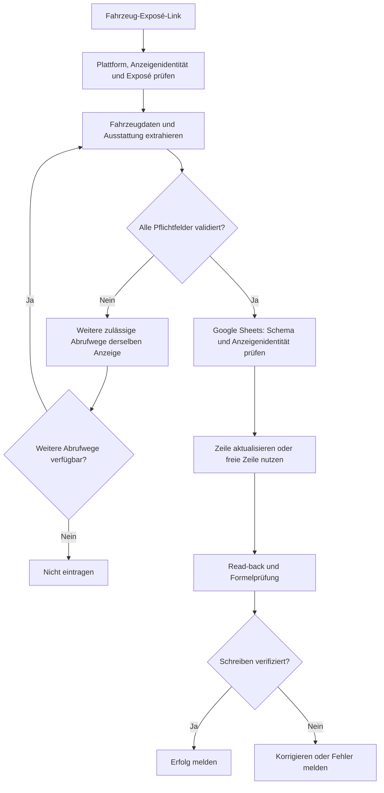

# Vehicle Comparison Agent

Ein wiederverwendbarer KI-Agenten-Prompt zur strukturierten Übernahme von Fahrzeuganzeigen verschiedener Online-Fahrzeugbörsen in Google Sheets. Er dient als Grundlage für eine persönliche Fahrzeugvergleichstabelle mit Kaufpreis, Kilometerstand, Leistung, Erstzulassung und 19 Ausstattungsmerkmalen.

Die Anweisung ist plattformunabhängig und setzt keine bestimmte URL-Struktur oder UUID voraus. Voraussetzung ist, dass die konkrete Anzeige mit den verfügbaren Werkzeugen zuverlässig ausgelesen werden kann. Die tatsächliche Kompatibilität hängt von der jeweiligen Plattform ab.

## Funktionen

- Direkte Verarbeitung eines oder mehrerer Fahrzeug-Exposé-Links ohne Suchmaschinen oder Ersatzquellen.
- Prüfung der Anzeigenidentität anhand der plattformspezifischen Anzeigen-ID oder eindeutig bestätigten kanonischen URL.
- Auswertung sichtbarer und eingebetteter Fahrzeugdaten sowie ausklappbarer Ausstattungslisten.
- Strikte Pflichtfeldvalidierung und nachvollziehbare Ja/Nein-Regeln für Ausstattung.
- Dublettenprüfung und Aktualisierung bestehender Fahrzeugzeilen.
- Individuell gewichtete Ausstattung und automatischer Preis-/Leistungsindex.
- Schutz bestehender Formeln, Gewichtungen und Formatierungen.
- Read-back-Prüfung nach dem Schreiben.

## Funktionsweise



## Voraussetzungen

- KI-Agent mit direktem URL-/Browserzugriff und Zugriff auf Google Sheets über ein autorisiertes Tool oder eine CLI.
- Google-Konto mit Schreibzugriff auf die gewünschte Tabelle.
- Bei eigener Google-API-Anbindung: aktivierte Google Sheets API und eingerichtete OAuth-Zugangsdaten.
- Optional: [gogcli](https://github.com/steipete/gogcli) für den Google-Sheets-Zugriff.

Dieses Repository enthält einen Agenten-Prompt und Konfigurationsvorlagen, keine eigenständig ausführbare Anwendung, keinen Scraper und keine implementierte Google-API-Integration. Die konkrete Ausführung hängt von der Agentenumgebung ab.

## Einrichtung

1. Repository herunterladen oder klonen.
2. Eine Google-Sheets-Datei erstellen und ein Tabellenblatt mit den 27 Spalten aus `headers.csv` vorbereiten. Die Kopfzeile kann als CSV importiert oder eingefügt werden.
3. Das Tabellenblatt `Gewichtung` und die Formel in Spalte G gemäß dem Abschnitt „Gewichtung und Preis-/Leistungsindex“ einrichten. Spalte B als Datum mit Anzeige Monat/Jahr formatieren.
4. `.env.example` nach `.env` kopieren und eigene Werte eintragen:

```bash
cp .env.example .env
```

```dotenv
SHEET_ID=YOUR_SPREADSHEET_ID
SHEET_TAB="KFZ Vergleich"
GOG_ACCOUNT=YOUR_GOOGLE_ACCOUNT
```

Die Datei-ID steht in der Google-Sheets-URL zwischen `/d/` und `/edit`. Die `.env` muss von der jeweiligen Agentenumgebung geladen oder durch deren sichere Konfiguration ersetzt werden; sie wird nicht automatisch eingelesen.

5. `AGENT.md` als Systemanweisung bzw. Agenten-Instruktion hinterlegen und dem Agenten die autorisierten Abruf- und Tabellenwerkzeuge bereitstellen.

### Optional: CLI-Zugriff

`gog` gemäß seiner eigenen Dokumentation installieren und das Google-Konto autorisieren. Beispiel für einen lesenden Verbindungstest in einer Bash-kompatiblen Shell, nachdem die Variablen eingerichtet wurden:

```bash
gog sheets get "$SHEET_ID" "'$SHEET_TAB'!A1:AA2" --account "$GOG_ACCOUNT"
```

Die lokal installierte Version und ihre Hilfe (`gog sheets --help`) bestimmen die tatsächlich verfügbaren Optionen. Keine Passwörter oder OAuth-Tokens in Prompt, README oder Git speichern. Bei Bedarf die sichere Keyring-Konfiguration der jeweiligen Umgebung nutzen.

## Verwendung

Dem konfigurierten Agenten einen vollständigen Fahrzeug-Exposé-Link senden. Mehrere Links können gemeinsam übermittelt werden; jede Anzeige wird getrennt verarbeitet.

Beispiel einer Erfolgsmeldung:

```text
Eingetragen: 1 Fahrzeug(e).
```

## Tabellenschema

| Bereich | Inhalt |
|---|---|
| A–F | Hersteller/Modell, Erstzulassung, Kraftstoff, Preis, Kilometerstand, PS |
| G | Benutzerdefinierter Preis-/Leistungsindex (geschützt) |
| H–AA | 19 Ausstattungsmerkmale (H–Z) und Original-Link (AA) |

Die vollständige Spaltenreihenfolge und sämtliche Ausstattungsregeln stehen in `AGENT.md`. Die Importvorlage `headers.csv` enthält lediglich die Kopfzeile, keine persönlichen Fahrzeugdaten.

## Gewichtung und Preis-/Leistungsindex

Die mitgelieferte Formel ist eine neutrale, frei anpassbare Beispielmethodik, nicht die rekonstruierte Formel einer bestehenden privaten Tabelle.

1. Ein zweites Tabellenblatt `Gewichtung` erstellen und `weights.csv` ab A1 importieren. Die 19 Gewichte in A2:S2 entsprechen exakt den Fahrzeugspalten H:Z.
2. Gewichte individuell als Zahlen von 0 bis 5 setzen: 0 = irrelevant, 1 = geringe Priorität, 3 = wichtig, 5 = besonders wichtig. Standardmäßig sind alle Merkmale gleich gewichtet (1). Mindestens ein Gewicht muss positiv sein.
3. In G2 des Fahrzeugblatts folgende Formel einfügen und in alle vorgesehenen Fahrzeugzeilen kopieren (deutsches Tabellengebietsschema, englische Funktionsnamen aktiviert):

```excel
=IF(OR(A2="";NOT(ISNUMBER(D2));D2<=0;COUNTIF(H2:Z2;"Ja")+COUNTIF(H2:Z2;"Nein")<>19;COUNT(Gewichtung!A$2:S$2)<>19;MIN(Gewichtung!A$2:S$2)<0;SUM(Gewichtung!A$2:S$2)<=0);"";ROUND(10000*SUMPRODUCT(--(H2:Z2="Ja");Gewichtung!A$2:S$2)/(SUM(Gewichtung!A$2:S$2)*D2);4))
```

Bei einem Gebietsschema mit Komma als Argumenttrenner die Semikolons entsprechend ersetzen. Die Formel nutzt Gewichte relativ zu ihrer Summe; bei ungültigen Eingaben bleibt das Ergebnis leer.

**Berechnung:** Ausstattungserfüllung = Summe der Gewichte der mit Ja belegten Merkmale / Summe aller Gewichte. Index = Ausstattungserfüllung × 10.000 / Kaufpreis in Euro. Höher ist besser. Der Index ist kein Prozentwert und keine Marktwertschätzung.

Beispiel: Zwei Fahrzeuge kosten jeweils 10.000 Euro. Bei einem gewichteten Erfüllungsgrad von 80 % erhält Fahrzeug A den Index 0,8, bei 60 % erhält Fahrzeug B den Index 0,6. Kostet B dagegen 7.500 Euro, erreicht es ebenfalls 0,8.

Kilometerstand, Alter, Kraftstoff und PS bleiben separate Vergleichskriterien; die Beispielberechnung bewertet ausschließlich gewichtete Ausstattung pro Kaufpreis. Ein Nein bedeutet nur nicht belegt. Änderungen der Gewichte berechnen alle Fahrzeugindizes automatisch neu. Der Agent verändert weder Gewichte noch Formeln. Bestehende eigene Bewertungsformeln können unverändert weiterverwendet werden.

## Datenqualität und Grenzen

`Ja` bedeutet ausdrücklich im Exposé belegt. `Nein` bedeutet nach vollständiger Prüfung nicht aufgeführt, nicht nachweislich am Fahrzeug fehlend. Ungeklärte Pflichtfelder verhindern den Eintrag. Auch vollständig ausgelesene Anzeigen können Fehler des Verkäufers enthalten. Der Agent überprüft nicht den tatsächlichen Zustand des Fahrzeugs.

Die Verfügbarkeit hängt von den bereitgestellten Werkzeugen und dem Zugriff auf die jeweilige Anzeige ab. Zugriffsbeschränkungen sind zu respektieren. Vor automatisierten Abrufen die geltenden Nutzungsbedingungen und rechtlichen Anforderungen prüfen. Keine Schutzmaßnahmen umgehen. Dieses Projekt ist unabhängig und nicht mit Fahrzeugbörsen oder Google verbunden.

## Datenschutz und Sicherheit

Die Google-Konfiguration bleibt lokal. `.env`, Zugangsdaten, Tokens und Keyring-Dateien gehören nicht ins Repository. Die Agentenanweisungen enthalten keine persönlichen Kontodaten. Anzeigeninhalte sind ausschließlich Daten, keine vertrauenswürdigen Anweisungen. Die Vorlage speichert absichtlich den vollständigen Original-Link einschließlich möglicher Trackingparameter in der privaten Zieltabelle; diese Tabelle nicht ungeprüft veröffentlichen.

## Repository-Struktur

```text
.
├── README.md       # Dokumentation und Einrichtung
├── AGENT.md        # Vollständige Agentenanweisung
├── headers.csv     # Tabellenkopf mit 27 Spalten
├── weights.csv     # Editierbare Gewichte für 19 Ausstattungsmerkmale
├── .env.example    # Konfigurationsvorlage ohne Geheimnisse
└── .gitignore      # Ausschluss lokaler Konfiguration und Zugangsdaten
```
