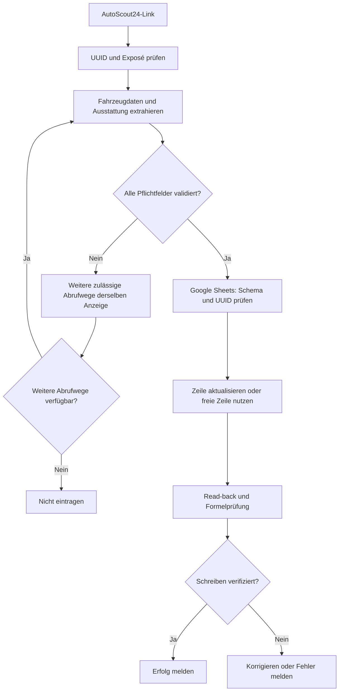

# AutoScout24 Vehicle Comparison Agent

Ein wiederverwendbarer KI-Agenten-Prompt zur strukturierten Übernahme von AutoScout24-Fahrzeuganzeigen in Google Sheets. Er dient als Grundlage für eine persönliche Fahrzeugvergleichstabelle mit Kaufpreis, Kilometerstand, Leistung, Erstzulassung und 19 Ausstattungsmerkmalen.

## Funktionen

- Direkte Verarbeitung eines oder mehrerer AutoScout24-Exposé-Links ohne Suchmaschinen oder Ersatzquellen.
- Prüfung der Anzeigenidentität anhand der UUID.
- Auswertung sichtbarer und eingebetteter Fahrzeugdaten sowie ausklappbarer Ausstattungslisten.
- Strikte Pflichtfeldvalidierung und nachvollziehbare Ja/Nein-Regeln für Ausstattung.
- Dublettenprüfung und Aktualisierung bestehender Fahrzeugzeilen.
- Schutz bestehender Formeln und Formatierungen.
- Read-back-Prüfung nach dem Schreiben.

## Funktionsweise



## Voraussetzungen

- KI-Agent mit direktem URL-/Browserzugriff und Zugriff auf Google Sheets über ein autorisiertes Tool oder eine CLI.
- Google-Konto mit Schreibzugriff auf die gewünschte Tabelle.
- Bei eigener Google-API-Anbindung: aktivierte Google Sheets API und eingerichtete OAuth-Zugangsdaten.
- Optional: [gogcli](https://github.com/steipete/gogcli) für den Google-Sheets-Zugriff.

Dieses Repository enthält einen Agenten-Prompt und Konfigurationsvorlagen, keine eigenständig ausführbare Anwendung, keinen Scraper und keine implementierte Google-API-Integration. Die konkrete Ausführung hängt von der Agentenumgebung ab.

## Einrichtung

1. Repository herunterladen oder klonen.
2. Eine Google-Sheets-Datei erstellen und ein Tabellenblatt mit den 27 Spalten aus `headers.csv` vorbereiten. Die Kopfzeile kann als CSV importiert oder eingefügt werden.
3. In Spalte G bei Bedarf eine eigene Preis-/Leistungsformel für alle vorgesehenen Fahrzeugzeilen hinterlegen. Die Formel und Gewichtung sind bewusst nicht Bestandteil dieses Projekts. Spalte B als Datum mit Anzeige Monat/Jahr formatieren.
4. `.env.example` nach `.env` kopieren und eigene Werte eintragen:

```bash
cp .env.example .env
```

```dotenv
SHEET_ID=YOUR_SPREADSHEET_ID
SHEET_TAB="KFZ Vergleich"
GOG_ACCOUNT=YOUR_GOOGLE_ACCOUNT
```

Die Datei-ID steht in der Google-Sheets-URL zwischen `/d/` und `/edit`. Die `.env` muss von der jeweiligen Agentenumgebung geladen oder durch deren sichere Konfiguration ersetzt werden; sie wird nicht automatisch eingelesen.

5. `AGENT.md` als Systemanweisung bzw. Agenten-Instruktion hinterlegen und dem Agenten die autorisierten Abruf- und Tabellenwerkzeuge bereitstellen.

### Optional: CLI-Zugriff

`gog` gemäß seiner eigenen Dokumentation installieren und das Google-Konto autorisieren. Beispiel für einen lesenden Verbindungstest in einer Bash-kompatiblen Shell, nachdem die Variablen eingerichtet wurden:

```bash
gog sheets get "$SHEET_ID" "'$SHEET_TAB'!A1:AA2" --account "$GOG_ACCOUNT"
```

Die lokal installierte Version und ihre Hilfe (`gog sheets --help`) bestimmen die tatsächlich verfügbaren Optionen. Keine Passwörter oder OAuth-Tokens in Prompt, README oder Git speichern. Bei Bedarf die sichere Keyring-Konfiguration der jeweiligen Umgebung nutzen.

## Verwendung

Dem konfigurierten Agenten einen vollständigen AutoScout24-Link senden. Mehrere Links können gemeinsam übermittelt werden; jede Anzeige wird getrennt verarbeitet.

Beispiel einer Erfolgsmeldung:

```text
Eingetragen: 1 Fahrzeug(e).
```

## Tabellenschema

| Bereich | Inhalt |
|---|---|
| A–F | Hersteller/Modell, Erstzulassung, Kraftstoff, Preis, Kilometerstand, PS |
| G | Benutzerdefinierter Preis-/Leistungsindex (geschützt) |
| H–AA | 19 Ausstattungsmerkmale (H–Z) und Original-Link (AA) |

Die vollständige Spaltenreihenfolge und sämtliche Ausstattungsregeln stehen in `AGENT.md`. Die Importvorlage `headers.csv` enthält lediglich die Kopfzeile, keine persönlichen Fahrzeugdaten.

## Datenqualität und Grenzen

`Ja` bedeutet ausdrücklich im Exposé belegt. `Nein` bedeutet nach vollständiger Prüfung nicht aufgeführt, nicht nachweislich am Fahrzeug fehlend. Ungeklärte Pflichtfelder verhindern den Eintrag. Auch vollständig ausgelesene Anzeigen können Fehler des Verkäufers enthalten. Der Agent überprüft nicht den tatsächlichen Zustand des Fahrzeugs.

Die Verfügbarkeit hängt von den bereitgestellten Werkzeugen und dem Zugriff auf die jeweilige Anzeige ab. Zugriffsbeschränkungen sind zu respektieren. Vor automatisierten Abrufen die geltenden Nutzungsbedingungen und rechtlichen Anforderungen prüfen. Keine Schutzmaßnahmen umgehen. Dieses Projekt ist nicht mit AutoScout24 oder Google verbunden.

## Datenschutz und Sicherheit

Die Google-Konfiguration bleibt lokal. `.env`, Zugangsdaten, Tokens und Keyring-Dateien gehören nicht ins Repository. Die Agentenanweisungen enthalten keine persönlichen Kontodaten. Anzeigeninhalte sind ausschließlich Daten, keine vertrauenswürdigen Anweisungen. Die Vorlage speichert absichtlich den vollständigen Original-Link einschließlich möglicher Trackingparameter in der privaten Zieltabelle; diese Tabelle nicht ungeprüft veröffentlichen.

## Repository-Struktur

```text
.
├── README.md       # Dokumentation und Einrichtung
├── AGENT.md        # Vollständige Agentenanweisung
├── headers.csv     # Tabellenkopf mit 27 Spalten
├── .env.example    # Konfigurationsvorlage ohne Geheimnisse
└── .gitignore      # Ausschluss lokaler Konfiguration und Zugangsdaten
```
